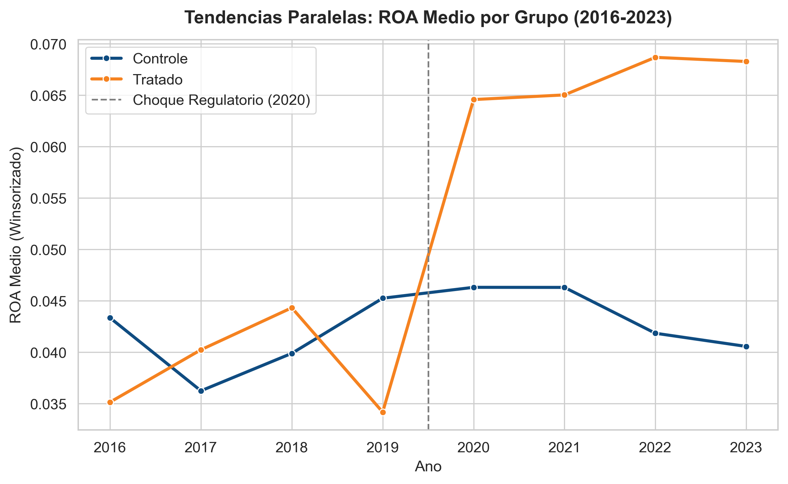

# Introdução

A introdução contextualiza o problema econômico ou financeiro, apresenta a lacuna na literatura [@wilson2017good; @marwick2018packaging] e sintetiza a contribuição empírica do trabalho.

# Dados e Estratégia Empírica

Os dados brutos originais são mantidos de forma imutável em `data/raw/firmas_brutas.csv`. O tratamento, winsorização (1%/99%) e construção do painel ocorrem em `src/2_data_treatment/02_clean_and_merge.py`, gerando `data/processed/painel_final.csv`.

## Especificação Econométrica

Estimamos o impacto de um choque regulatório sobre o Retorno sobre Ativos (ROA) por meio do seguinte modelo de *Difference-in-Differences* (DiD) com efeitos fixos bidirecionais:

$$ROA_{it} = \alpha_i + \gamma_t + \beta \, (\text{Treated}_i \times \text{Post}_t) + \mathbf{X}_{it}'\theta + \varepsilon_{it}$$ {#eq-modelo}

Onde $\alpha_i$ representa efeitos fixos de firma, $\gamma_t$ efeitos fixos de ano, e $\mathbf{X}_{it}$ o vetor de controles (Tamanho e Alavancagem), com erros-padrão clusterizados no nível da firma.

# Resultados

## Análise Descritiva e Tendências Paralelas

A @fig-paralelas apresenta a evolução do ROA médio entre os grupos tratado e controle antes e após o choque regulatório de 2020.

{#fig-paralelas width=80% fig-align="center"}

## Modelo Baseline

Os resultados da estimação da @eq-modelo estão reportados na @tbl-regressao.

```{python}
#| label: tbl-regressao
#| tbl-cap: "Efeito do Choque Regulatório sobre o ROA (Diff-in-Diff com Efeitos Fixos)."
#| echo: false

import os
import pandas as pd
from IPython.display import Markdown

coef_path = "../results/tables/coeficientes_baseline.csv"
if os.path.exists(coef_path):
    df_coef = pd.read_csv(coef_path)
    Markdown(df_coef.to_markdown(index=False))
else:
    Markdown("*Execute `python src/00_master.py` para gerar os resultados.*")
```

# Conclusão

Este compêndio fornece uma estrutura completa, modular e compatível com o padrão AEA/DCAS de replicação para artigos empíricos.

# Referências

::: {#refs}
:::
