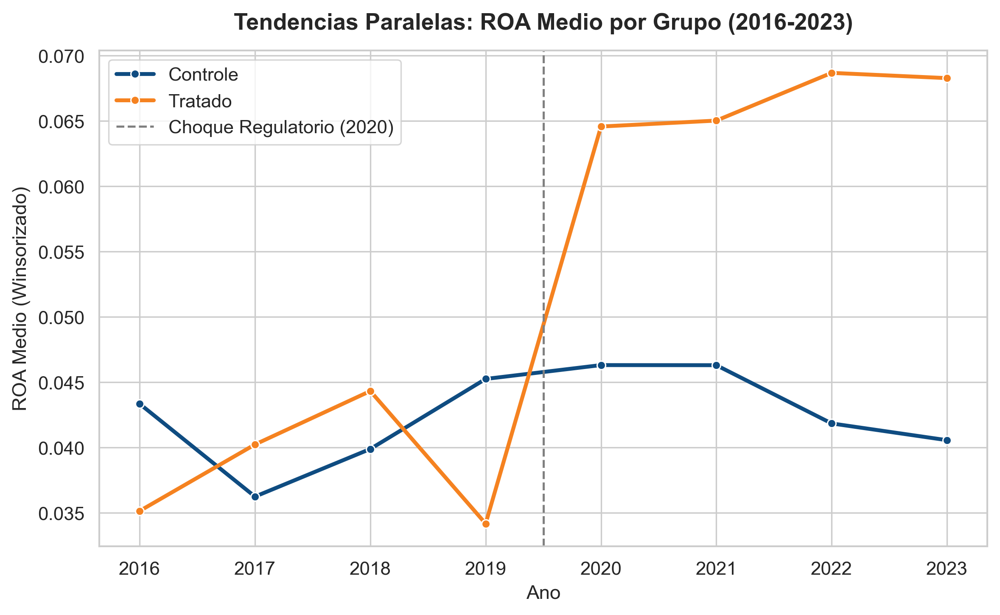

## Motivação e Pergunta de Pesquisa

- Contexto econômico / financeiro do problema.
- **Pergunta de pesquisa:** Qual o efeito de [X] sobre [Y]?
- Por que isso importa para a literatura e para formuladores de política / mercado?

## Dados e Estratégia Empírica

- **Amostra:** Painel de firmas-ano (2016–2023).
- **Identificação:** Difference-in-Differences (DiD) com efeitos fixos de firma e ano:

$$Y_{it} = \alpha_i + \gamma_t + \beta \, (\text{Treated}_i \times \text{Post}_t) + \mathbf{X}_{it}'\theta + \varepsilon_{it}$$

## Tendências Paralelas

{fig-align="center" width="75%"}

## Resultados Principais e Conclusões

- O coeficiente $\hat{\beta}$ indica impacto positivo e estatisticamente significativo sobre o ROA.
- Resultados permanecem robustos ao teste placebo e à substituição por Q de Tobin.
